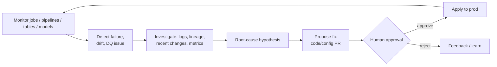
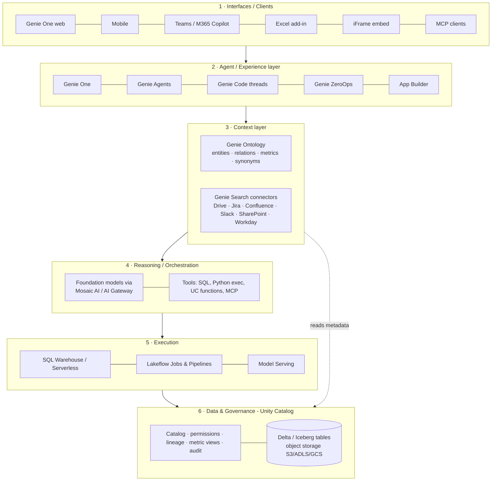
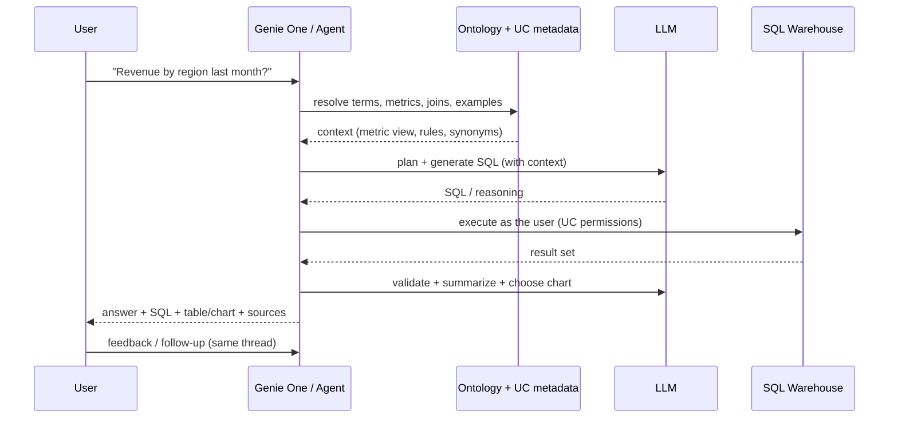
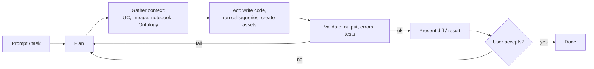
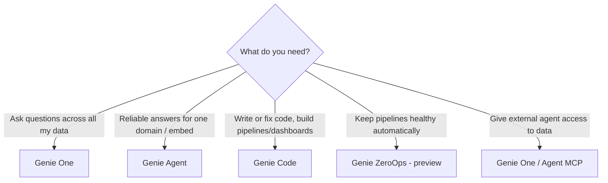

# Databricks Genie – Reference Card & Cheat Sheet (Nov 2026)

> Covers: **Genie One · Genie Agents · Genie Code · Genie Ontology · Genie ZeroOps** (+ App Builder).
> Sources: Databricks docs/newsroom, DAIS 2026 recaps, community analyses (retrieved Nov 2026).
> ⚠️ Items marked **[verify]** come from secondary sources or are illustrative. Product names, preview status, and APIs change quickly – always confirm in `docs.databricks.com`.

---

## 1. TL;DR

| Component | One-liner | Audience | Status* |
|---|---|---|---|
| **Genie One** | Agentic "coworker" app: ask questions, get answers, automate work across all data you can access | Business users | GA (June 2026) |
| **Genie Agents** | Curated, scoped, shareable domain agents (formerly *Genie Spaces*) | Data teams → business | GA (renamed July 2026) |
| **Genie Code** | Autonomous coding/data agent in the workspace (formerly *Databricks Assistant*) | Data/ML engineers, analysts | GA |
| **Genie Ontology** | Live, self-improving business-context/knowledge layer under everything | Platform (invisible) | Public preview / partly private preview [verify] |
| **Genie ZeroOps** | Background agent that monitors, investigates, proposes fixes for pipelines/jobs/tables/models | Data engineers/ops | Private preview |
| **Genie App Builder** | Build apps from prompts on Databricks | Builders | Private preview |

\*Status differs between sources; check your workspace "Previews" page.

**Naming history (avoid confusion):**
- 2024: *AI/BI Genie* (text-to-SQL chat) → 
- **Databricks One → Genie One** (April 2026) → GA June 2026 (Data + AI Summit)
- **Genie Spaces → Genie Agents** (July 2026)
- **Databricks Assistant → Genie Code**

---

## 2. Basics & Core Concepts

### 2.1 Mental model
```
Genie One      = the interface (ask, orchestrate)
Genie Agents   = the curated context for a domain (tables, metrics, rules, examples)
Genie Ontology = the automated knowledge layer (entities, relations, meaning)
Genie Code     = the builder (notebooks, pipelines, dashboards, ML)
Genie ZeroOps  = the operator (monitor, root-cause, propose fix)
Unity Catalog  = the governance plane under all of it
```

### 2.2 Key concepts

| Concept | Explanation |
|---|---|
| **Compound AI system** | Genie is not a single LLM call: it plans, retrieves context, generates SQL/code, executes, validates, and explains |
| **Governed by Unity Catalog (UC)** | Answers respect user permissions (row filters, column masks, ABAC); lineage and audit apply |
| **Semantic grounding** | Business terms → tables/columns/metrics via UC metadata, metric views, Ontology, Agent instructions |
| **Text-to-SQL with trusted assets** | Prefers curated example SQL, SQL functions, and certified metric views over free-form guessing |
| **Agentic loop** | Plan → gather context → act (SQL/code/tool) → check → respond/iterate |
| **Human-in-the-loop** | ZeroOps requires approval before fixes go to production; Genie Code changes are reviewable (diff/accept) |
| **Benchmarks** | Test question/SQL pairs to measure agent accuracy (aim ≥5) |
| **Conversation thread** | Stateful follow-up context; start a **new thread per user session** for accuracy |
| **Budgets** | Admin-managed spend controls for Genie usage |

### 2.3 Pricing/licensing snapshot (from docs)
- **Genie One & Genie Agents**: user interactions **free through Jan 31, 2027**; underlying compute (SQL warehouse) still applies.
- **Genie Code**: pay-as-you-go from **July 8, 2026**, with a per-user free monthly allowance.
- Underlying **Databricks SQL / serverless compute** costs apply to generated queries.

---

## 3. Components in Detail

### 3.1 Genie One
- Simplified UI for business users to **discover and interact with data assets** across everything the user may access – no pre-built agent required.
- Answers are grounded in **Genie Ontology**; uses **SQL against curated, authoritative data** rather than guessing from document fragments.
- Surfaces: web app, **mobile**, Microsoft **Teams / M365 Copilot**, **Excel add-in**, **iframe embeds**, **managed MCP server**, **Genie One API (Beta)** [verify exact list].
- Features: conversational Q&A, charts, follow-ups, org-directory lookups (people source, e.g. Workday), cross-app search (Genie Search), task orchestration, scheduled tasks/skills [verify].

### 3.2 Genie Agents (ex-Spaces)
Domain-specific, shareable agents that data teams configure.

| Element | Purpose |
|---|---|
| **Data sources** | UC tables/views/**metric views** (keep the set small & focused) |
| **Table/column descriptions & synonyms** | Disambiguate meaning; enable value dictionaries / example values |
| **General instructions** | Plain-text business rules ("last month = previous calendar month") |
| **Example SQL (question → SQL)** | Strongest accuracy lever; aim ≥5 tested |
| **SQL functions / UDFs (trusted assets)** | Parameterized, certified logic |
| **Join definitions** | Explicit relationships between tables |
| **Benchmarks** | Regression tests for accuracy |
| **Sample questions** | Onboarding for end users |
| **SQL warehouse** | Compute (pro/serverless; users need CAN USE) |
| **Sharing/permissions** | CAN VIEW / RUN / EDIT / MANAGE style roles |
| **Monitoring/feedback** | Thumbs up/down, review of conversations, improvement loop |
| **APIs** | Conversation API + Management API (CI/CD) |

### 3.2.1 Best-practice curation checklist
1. Fewer, well-annotated tables (UC comments on tables **and** columns).
2. Add ≥5 tested example SQLs; ≥5 benchmarks.
3. Encode business definitions in **metric views** instead of prose when possible.
4. Write instructions concisely and unambiguously; avoid contradictions.
5. Enable value dictionaries for low-cardinality categorical columns.
6. Test with real user phrasing; review failed answers weekly.
7. New conversation per session via API.

### 3.3 Genie Code
Autonomous AI agent to **plan, build, and run** data engineering, ML, and analytics work.
- **Surfaces**: notebooks, SQL editor, Lakeflow pipelines/jobs, dashboards, files/workspace.
- **Modes**: chat, **inline suggestions/completions**, **agent mode** (multi-step tasks), parallel **threads** scoped to notebooks/pipelines.
- **Capabilities**: write/refactor/debug code (SQL, Python, PySpark, DLT/Lakeflow), explain errors, generate dashboards, build ML workflows, **import Power BI (incl. PBIR) and Tableau workbooks** and rebuild natively, document tables, use user/workspace **skills** [verify naming].
- **Context**: UC metadata, lineage, Ontology, workspace objects.
- **Controls**: review/accept diffs, permissions of the invoking user, budgets.

### 3.4 Genie Ontology
- Automatically **extracts & continuously updates business knowledge** from Databricks (UC metadata, metric views, dashboards variables/bookmarks, query history) **and connected apps** (Google Drive, Jira, Slack, Confluence, SharePoint, Workday…).
- Maps *business meaning* → entities, relationships, metrics, synonyms; **"self-improving"** through usage/feedback.
- Consumed by Genie One, Genie Code, (and Agents / MCP).
- **Genie Search**: connector setup for external sources; **people source** (Workday) for org directory.
- Think: "Knowledge graph + semantic layer, maintained automatically."

### 3.5 Genie ZeroOps (private preview)
Background agent that **monitors → detects → investigates → proposes fixes** for pipelines, jobs, tables, ML models.


- **Mandatory human approval** before production changes.
- Use cases: failed job triage, schema drift, late data, DQ expectation failures, cost/perf regressions [verify].

### 3.6 Genie App Builder (private preview)
Prompt-to-app on Databricks (Databricks Apps), governed by UC. Evaluate as preview.

---

## 4. Architecture

### 4.1 Six layers, one governance plane


*(Layer naming follows community analyses; Databricks does not publish this exact diagram [verify].)*

### 4.2 Question-answer flow (Genie One / Agent)



### 4.3 Genie Code agentic loop



### 4.4 Security & governance model
- **Identity**: runs as the calling user (OAuth U2M) or service principal (OAuth M2M); no privilege escalation.
- **Authorization**: UC grants, row filters, column masks, ABAC apply to every generated query.
- **Audit**: system tables / audit logs capture usage [verify exact tables].
- **Data residency**: models via Databricks-hosted/partner-powered AI; check "Partner-powered AI features" workspace settings and geo-rules.
- **Guardrails**: AI Gateway policies (rate limits, PII filters, logging) [verify applicability].

---

## 5. Protocols, Storage, Formats

| Area | Details |
|---|---|
| **Transport** | HTTPS/REST (JSON); **Server-Sent Events (SSE, `text/event-stream`)** for Genie One API streaming |
| **Auth** | OAuth U2M (users), OAuth M2M (service principals), PATs (dev/test only) |
| **Agent protocol** | **MCP (Model Context Protocol)** servers: managed `system.ai.genie_one_mcp` (GA), Genie Agent MCP, Databricks SQL MCP (`/api/2.0/mcp/sql`, `system.ai.dbsql`), code interpreter `system.ai.python_exec` |
| **Storage – data** | Delta Lake (Parquet + transaction log) and Iceberg via UC on S3/ADLS/GCS |
| **Storage – config** | Agent definitions (workspace objects) as serialized JSON (`serialized_space`) incl. instructions, example SQLs, benchmarks |
| **Storage – ontology** | Managed by Databricks (knowledge graph/index); sources: UC + connectors [implementation internals not public] |
| **Result formats** | Query results as JSON/`INLINE` or `EXTERNAL_LINKS` (Arrow/CSV via presigned URLs) through SQL Statement API-style attachments [verify]; charts rendered in UI |
| **Code artifacts** | `.py`, `.sql`, notebooks (`.ipynb`/Databricks source), Lakeflow pipeline YAML/SQL, dashboards (`.lvdash.json`), Databricks Asset Bundles (`databricks.yml`) |
| **Import** | Power BI (PBIR/PBIX), Tableau workbooks → native dashboards via Genie Code |

---

## 6. Clients & Tools

| Client / Tool | Use |
|---|---|
| Genie One web / mobile | Business Q&A |
| Teams / M365 Copilot | Chat in collaboration tools |
| Excel add-in | Ask data questions in sheets |
| iFrame embed | Embed Genie in portals/apps |
| Databricks SDKs (Python, Java, Go, JS) | `w.genie.*` APIs |
| REST API | `/api/2.0/genie/...` |
| Databricks CLI | `databricks genie ...` [verify subcommands] |
| Databricks Asset Bundles / Terraform | CI/CD for agents & jobs |
| MCP clients (Claude Desktop, IDE agents, Python agents) | Use Genie as a tool |
| `databricks-langchain` (`GenieAgent`) | LangChain/LangGraph + Agent Framework |
| Agent Bricks / Mosaic AI Agent Framework | Multi-agent supervisors with Genie as sub-agent |
| Unity Catalog, Lakeflow, Jobs, Dashboards | Surrounding platform |

---

## 7. Setup & Configuration Snippets

### 7.1 Prerequisites checklist
```text
[ ] Workspace with Unity Catalog + Databricks SQL entitlement
[ ] Serverless or Pro SQL warehouse (CAN USE for users/service principal)
[ ] Tables/columns commented in UC; metric views for key KPIs
[ ] Partner-powered AI features enabled (admin settings) [verify]
[ ] Genie One API preview enabled (Workspace admin → Previews) – for API use
[ ] Budgets configured for Genie (admin)
```

### 7.2 Annotate data in Unity Catalog (SQL)
```sql
COMMENT ON TABLE main.sales.orders IS 'One row per customer order; amounts in USD';
ALTER TABLE main.sales.orders ALTER COLUMN order_amt COMMENT 'Gross order amount in USD, incl. tax';
ALTER TABLE main.sales.orders ALTER COLUMN status COMMENT 'Order status: NEW, PAID, SHIPPED, CANCELLED';

-- Optional: certify trusted assets with tags
ALTER TABLE main.sales.orders SET TAGS ('certified' = 'true', 'domain' = 'sales');
```

### 7.3 Define a metric view (trusted semantics) [syntax: verify against current docs]
```sql
CREATE VIEW main.sales.orders_metrics
WITH METRICS
LANGUAGE YAML
AS $$
version: 0.1
source: main.sales.orders
dimensions:
  - name: region
    expr: region
  - name: order_month
    expr: date_trunc('MONTH', order_date)
measures:
  - name: total_revenue
    expr: SUM(order_amt)
  - name: order_count
    expr: COUNT(1)
$$;
```

### 7.4 Create a Genie Agent via API (Management API)
```bash
export HOST="https://<workspace-host>"
export TOKEN="<oauth-or-pat>"

curl -X POST "$HOST/api/2.0/genie/spaces" \
  -H "Authorization: Bearer $TOKEN" -H "Content-Type: application/json" \
  -d '{
    "title": "Sales Analytics",
    "description": "Space for analyzing sales performance and trends",
    "parent_path": "/Workspace/Users/<username>",
    "warehouse_id": "<warehouse-id>",
    "serialized_space": "<JSON string: data_sources, instructions, example_question_sqls, benchmarks>"
  }'
```
Typical `serialized_space` content (pretty-printed; send as an escaped JSON string):
```json
{
  "data_sources": {
    "tables": [{
      "identifier": "main.sales.orders",
      "description": ["order data incl. order date, amount, customer information"],
      "column_configs": [
        {"column_name": "order_date", "get_example_values": true},
        {"column_name": "status", "get_example_values": true, "build_value_dictionary": true},
        {"column_name": "region", "get_example_values": true}
      ]
    }]
  },
  "instructions": {
    "text_instructions": [{"content": [
      "When asked about 'last month', use the previous calendar month (not the last 30 days).",
      "Round all monetary values to 2 decimal places."
    ]}],
    "example_question_sqls": [{
      "question": ["Show top 10 customers by revenue"],
      "sql": ["SELECT customer_name, SUM(order_amount) AS total_revenue\n",
              "FROM main.sales.orders GROUP BY customer_name ORDER BY 2 DESC LIMIT 10"]
    }]
  }
}
```
> Field names follow the docs excerpt; exact schema may evolve – export an existing agent to see the current shape.

### 7.5 Permissions (conceptual)
```text
Agent: grant CAN RUN to group "sales-analysts"; CAN EDIT to "data-stewards"
UC:    GRANT USE CATALOG, USE SCHEMA, SELECT on main.sales TO `sales-analysts`
WH:    CAN USE on SQL warehouse for the same group
```
```sql
GRANT USE CATALOG ON CATALOG main TO `sales-analysts`;
GRANT USE SCHEMA  ON SCHEMA  main.sales TO `sales-analysts`;
GRANT SELECT      ON TABLE   main.sales.orders TO `sales-analysts`;

-- Row-level security example
CREATE FUNCTION main.sales.region_filter(region STRING)
RETURN is_account_group_member('global-sales') OR region = 'EMEA';
ALTER TABLE main.sales.orders SET ROW FILTER main.sales.region_filter ON (region);
```

---

## 8. Operation Snippets

### 8.1 Genie Agents Conversation API (REST)
```bash
# 1) Start a conversation
curl -X POST "$HOST/api/2.0/genie/spaces/$SPACE_ID/start-conversation" \
  -H "Authorization: Bearer $TOKEN" -H "Content-Type: application/json" \
  -d '{"content": "Which customers did we reach out to via email yesterday?"}'
# → { "conversation_id": "...", "message_id": "...", ... }

# 2) Poll the message until status is COMPLETED
curl "$HOST/api/2.0/genie/spaces/$SPACE_ID/conversations/$CONV_ID/messages/$MSG_ID" \
  -H "Authorization: Bearer $TOKEN"

# 3) Fetch generated query result
curl "$HOST/api/2.0/genie/spaces/$SPACE_ID/conversations/$CONV_ID/messages/$MSG_ID/query-result/$ATTACHMENT_ID" \
  -H "Authorization: Bearer $TOKEN"

# 4) Follow-up in same conversation
curl -X POST "$HOST/api/2.0/genie/spaces/$SPACE_ID/conversations/$CONV_ID/messages" \
  -H "Authorization: Bearer $TOKEN" -H "Content-Type: application/json" \
  -d '{"content": "Break that down by region"}'

# 5) List conversations in an agent
curl "$HOST/api/2.0/genie/spaces/$SPACE_ID/conversations" -H "Authorization: Bearer $TOKEN"
```
**Tips:** new conversation per user session · exponential backoff if no response within ~2 min · prefer OAuth U2M for browser users, M2M for services.

### 8.2 Python SDK
```python
from databricks.sdk import WorkspaceClient

w = WorkspaceClient()                      # picks up OAuth/profile/env auth
SPACE_ID = "<genie-agent-id>"

msg = w.genie.start_conversation_and_wait(SPACE_ID, "Top 10 customers by revenue?")
print(msg.status)

for att in msg.attachments or []:
    if att.query:
        print("SQL:\n", att.query.query)
        res = w.genie.get_message_attachment_query_result(
            SPACE_ID, msg.conversation_id, msg.message_id, att.attachment_id)
        print(res.statement_response.result.data_array[:5])
    if att.text:
        print("Text:", att.text.content)

# Follow-up
follow = w.genie.create_message_and_wait(
    SPACE_ID, msg.conversation_id, "Only for EMEA")
```
> Method names per current SDK; verify with `help(w.genie)` as APIs evolve (Spaces→Agents rename may add aliases).

### 8.3 Genie One API (Beta) – streaming over SSE
Enable first: **Admin → Previews → Genie One API**.
```bash
curl -N -X POST "$HOST/api/2.0/genie/one/responses" \
  -H "Authorization: Bearer $TOKEN" -H "Content-Type: application/json" \
  -d '{"input": "What was revenue by region last quarter?"}'
# Stream events: response.created (contains conversation_id) … final answer

# Continue conversation
curl -N -X POST "$HOST/api/2.0/genie/one/responses" \
  -H "Authorization: Bearer $TOKEN" -H "Content-Type: application/json" \
  -d '{"conversation_id": "<id>", "input": "Compare with the prior quarter"}'

# Retrieve a response / list conversations
curl "$HOST/api/2.0/genie/one/conversations/<conv-id>/responses/<resp-id>" -H "Authorization: Bearer $TOKEN"
curl "$HOST/api/2.0/genie/one/conversations?page_size=20" -H "Authorization: Bearer $TOKEN"
```
```python
import json, requests
from databricks.sdk import WorkspaceClient

w = WorkspaceClient()
url = f"{w.config.host}/api/2.0/genie/one/responses"
headers = {**w.config.authenticate(), "Content-Type": "application/json"}

with requests.post(url, headers=headers, json={"input": "Revenue by region, last quarter"}, stream=True) as r:
    r.raise_for_status()
    for line in r.iter_lines(decode_unicode=True):
        if line and line.startswith("data:"):
            evt = json.loads(line[5:].strip())
            print(evt)               # progress + final answer events
```
Genie One has no curated agent requirement; it spans all data the caller can access and grounds in Ontology. It does **not** list Genie Agent conversations.

### 8.4 MCP integration
```text
Managed MCP endpoints (workspace-permission based):
  Genie One MCP     system.ai.genie_one_mcp        (GA – start here for analytics)
  Genie Agent MCP   scoped to one curated agent
  Databricks SQL    https://<host>/api/2.0/mcp/sql   |  system.ai.dbsql
  Code interpreter  system.ai.python_exec (via functions MCP)
```
Generic MCP client config (illustrative; exact URL pattern → see "Built-in MCP services" doc):
```json
{
  "mcpServers": {
    "databricks-genie-one": {
      "url": "https://<workspace-host>/api/2.0/mcp/<genie-one-endpoint>",
      "headers": { "Authorization": "Bearer <token>" }
    }
  }
}
```
**Choosing a server:** analytics across the estate → Genie One MCP · tightly scoped domain with curated rules → Genie Agent MCP · raw SQL control → DBSQL MCP.

### 8.5 Genie in an agent (LangChain / Agent Framework)
```python
from databricks_langchain.genie import GenieAgent   # pip install databricks-langchain

genie = GenieAgent(
    genie_space_id="<genie-agent-id>",
    genie_agent_name="sales_genie",
    description="Answers sales KPI questions from curated sales data.",
)
resp = genie.invoke({"messages": [{"role": "user", "content": "MoM revenue growth?"}]})
print(resp["messages"][-1].content)
```
Use inside a **supervisor/multi-agent** graph (Agent Bricks / LangGraph) with one Genie Agent per domain (sales, marketing, finance).

### 8.6 Genie Code – practical prompts
```text
# Notebook (agent mode)
"Read main.sales.orders, build a bronze→silver→gold Lakeflow pipeline with
 expectations for null order_id and negative amounts; add unit tests."

# Debug
"Why is this job failing? Check the last run's logs and suggest a fix."   (select error cell → Diagnose)

# Dashboard
"Create a dashboard on main.sales.orders_metrics: revenue trend, top regions, order count KPI."

# Migration
"Import this Power BI .pbix (PBIR) and recreate it as a Databricks dashboard."

# Documentation
"Generate table & column comments for main.sales.* based on data and lineage."
```
Good habits: scope threads to one notebook/pipeline; run parallel threads for independent tasks; always review the diff; commit to Git; pin tests.

### 8.7 Deploy agent config via Asset Bundles / CI/CD (conceptual)
```yaml
# databricks.yml (illustrative – Genie resource type availability: verify)
bundle:
  name: genie-sales
targets:
  prod:
    workspace: { host: https://<prod-host> }
resources:
  jobs:
    deploy_genie_agent:
      tasks:
        - task_key: push_agent
          spark_python_task:
            python_file: ./scripts/push_genie_agent.py   # calls POST /api/2.0/genie/spaces with serialized_space from Git
```
Pattern: keep `serialized_space` JSON in Git → PR review → pipeline calls Management API per environment → run benchmarks → promote.

### 8.8 ZeroOps (private preview) – operating pattern
```text
1. Request preview access / admin enables ZeroOps for workspace [verify]
2. Select scope: jobs, pipelines, tables, models (by tag/catalog/folder)
3. Configure notification channels + approver groups
4. Review incident → root-cause → proposed fix (diff/config change)
5. Approve / reject → fix applied; feedback improves future proposals
```
No public API/config schema documented yet – treat any code as unavailable until GA.

### 8.9 Connect Ontology sources (Genie Search)
```text
Admin / Settings → Genie → Ontology / Genie Search
 • Add connectors: Google Drive, Jira, Confluence, Slack, SharePoint
 • Add people source: Workday (org directory in Genie One)
 • Scope by space/site/project; respect source permissions
```
(UI path varies; follow "Set up Genie Search" docs.)

### 8.10 Monitoring usage & cost
```sql
-- Illustrative: consult system tables docs for exact Genie/AI billing schema [verify]
SELECT usage_date, sku_name, SUM(usage_quantity) AS dbus
FROM system.billing.usage
WHERE sku_name ILIKE '%GENIE%' OR billing_origin_product ILIKE '%GENIE%'
GROUP BY ALL ORDER BY usage_date DESC;
```
Plus: set **Genie budgets** (per-user/workspace) in admin settings.

---

## 9. Typical Use Cases

| Persona | Use case | Component |
|---|---|---|
| Executive / manager | Ad-hoc KPI Q&A, "why did revenue drop?" | Genie One |
| Sales/Finance/Marketing analyst | Self-service analytics with trusted definitions | Genie Agents |
| Business ops | Cross-source answers (data + Jira + Confluence) | Genie One + Ontology |
| Embedded analytics | Chat in portals, Teams, Excel | Genie One / Agents API, iframe |
| Data engineer | Build/refactor pipelines, tests, docs | Genie Code |
| Analyst | SQL authoring, dashboard generation | Genie Code |
| BI migration | Power BI/Tableau → Databricks dashboards | Genie Code |
| ML engineer | Feature pipelines, training notebooks, eval | Genie Code |
| Platform/DataOps | Incident triage & root-cause, fix proposals | ZeroOps |
| AI developer | Genie as tool in multi-agent systems / external LLM agents | MCP, Conversation API, Agent Bricks |
| Governance | Consistent definitions across tools | Ontology + metric views |

### Decision guide


---

## 10. Pros & Cons

### Pros
- **Governed by design**: UC permissions, lineage, audit apply everywhere.
- **One platform**: data, compute, semantics, and agents without moving data.
- **Automatic context** (Ontology) reduces manual semantic-layer upkeep.
- **Multiple entry points** (UI, API, MCP, Teams, Excel) for different personas.
- **Curated agents** + benchmarks make accuracy measurable and improvable.
- **Engineering productivity**: parallel Genie Code threads, BI migration accelerator.
- **Human-approval** model in ZeroOps limits blast radius.
- Free user interactions for One/Agents until Jan 31, 2027.

### Cons / Risks
- **Not plug-and-play**: poor metadata → poor answers; needs curation, benchmarks, owners.
- **Preview maturity**: ZeroOps, App Builder, parts of Ontology are not GA.
- **Naming churn** (One/Genie/Spaces/Agents/Assistant) complicates docs & training.
- **Lock-in**: ontology/context lives in Databricks; portability is limited.
- **Cost unpredictability**: Genie Code PAYG + warehouse compute; need budgets.
- **Non-determinism**: LLM-generated SQL/code can be wrong → review & test.
- **Connector sprawl & permissions** complexity in Ontology/Genie Search.
- **Limited transparency** of Ontology internals; no public config for ZeroOps.
- API surfaces differ (Agent Conversation API vs Genie One API Beta) and still evolve.

---

## 11. Best Practices & Pitfalls

| Do | Don't |
|---|---|
| Start small: 1 domain, ≤ ~10 tables | Dump entire catalog into an agent |
| Metric views for KPIs | Put complex formulas only in prose instructions |
| Benchmarks + weekly review | Ship without testing real user phrasing |
| New conversation per session (API) | Reuse one thread for many users/sessions |
| Service principal + least privilege for apps | Use personal PATs in production |
| Review & test Genie Code output; use Git | Auto-accept big diffs into prod |
| Set budgets & alerts | Assume "free" – compute still bills |
| Treat previews as previews | Build critical ops on ZeroOps today |

**Troubleshooting quick list**
- Wrong numbers → check column comments, add example SQL, define metric view.
- "No access" → UC grants + warehouse CAN USE for *that user/SP*.
- Slow/timeouts → warehouse sizing/serverless; backoff polling.
- API 404/403 → feature preview not enabled by admin; wrong host/space ID.
- Confusing results across Genie One vs Agent → One spans all data; Agent is scoped/curated.

---

## 12. Glossary

| Term | Meaning |
|---|---|
| **UC** | Unity Catalog – governance for data & AI assets |
| **Metric view** | Governed, reusable KPI/semantic definition in UC |
| **Trusted asset** | Certified example SQL / function Genie prefers |
| **MCP** | Model Context Protocol for exposing tools/data to agents |
| **SSE** | Server-Sent Events – HTTP streaming |
| **U2M / M2M** | User-to-machine / machine-to-machine OAuth |
| **Lakeflow** | Databricks pipelines & jobs (ETL/orchestration) |
| **Agent Bricks** | Databricks framework/product for building enterprise agents |
| **ABAC** | Attribute-based access control |
| **Benchmark** | Stored Q→expected-SQL test for an agent |

---

## 13. Key Links (verify current URLs)
- Genie docs: `docs.databricks.com/aws/en/genie/`
- Genie Agents API: `docs.databricks.com/aws/en/genie-agents/conversation-api`
- Genie One API (Beta): `docs.databricks.com/aws/en/genie-one/api`
- Built-in MCP services: Azure/AWS Databricks docs → "Built-in MCP services"
- Press: Databricks Newsroom – "Databricks Launches Genie One" and "Genie Code" releases
- DAIS 2026 recap (Atlan), Select.dev "Genie Explained", Addepto "Genie pricing & ROI" (third-party views)

---
*Generated Nov 22, 2026. Content reflects publicly available information at that time; preview features and APIs may have changed.*
