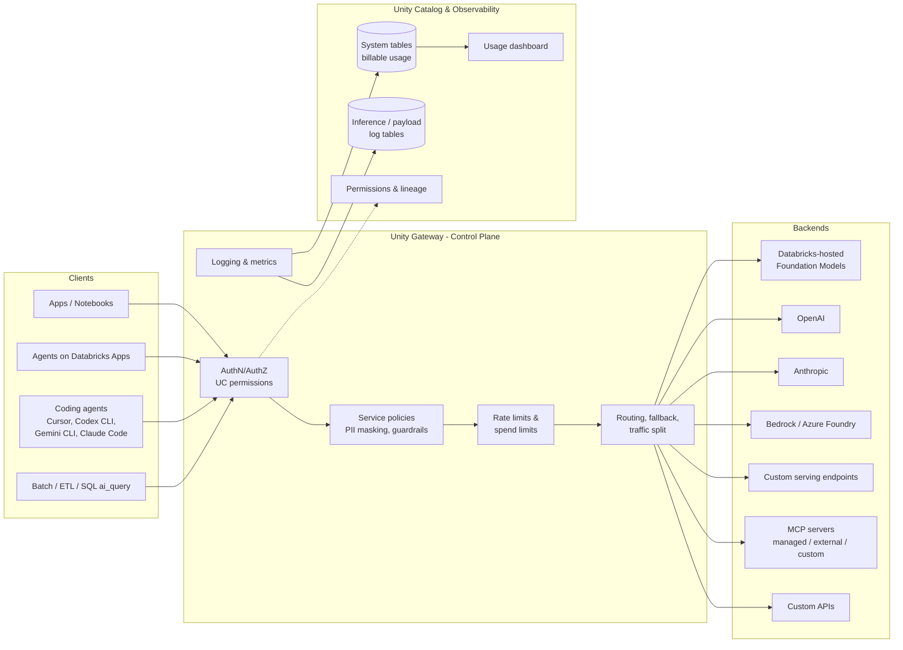
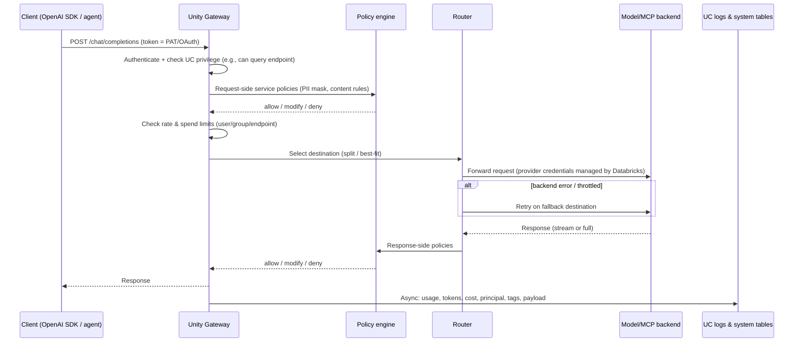
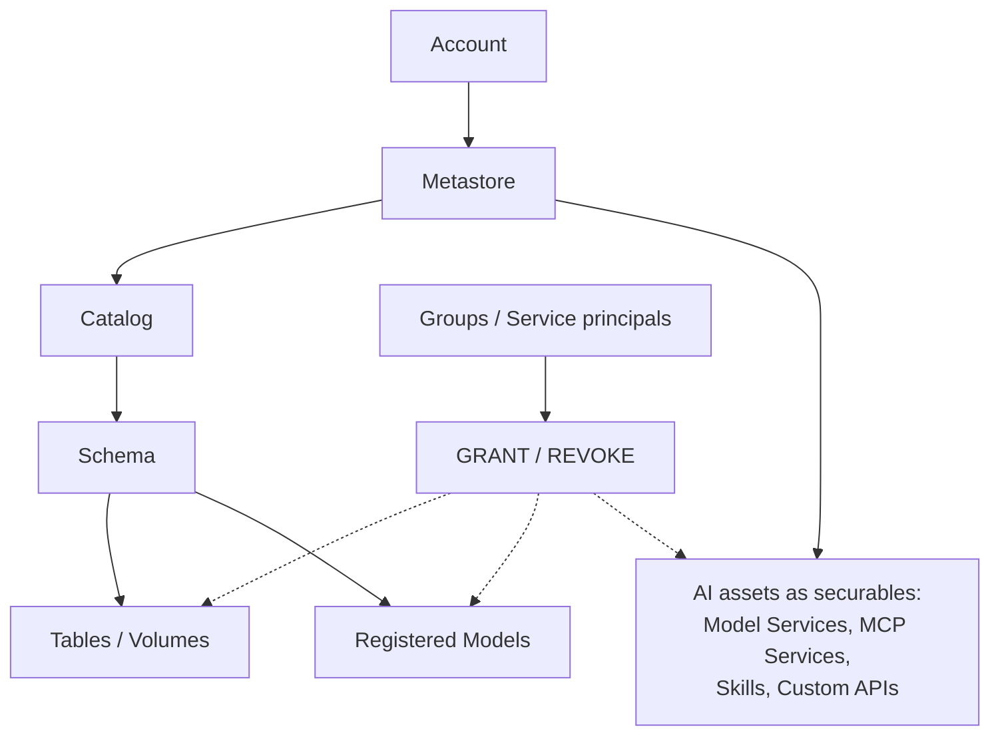
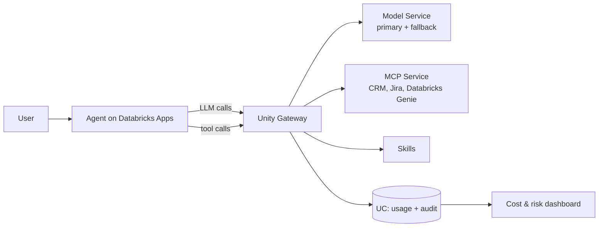
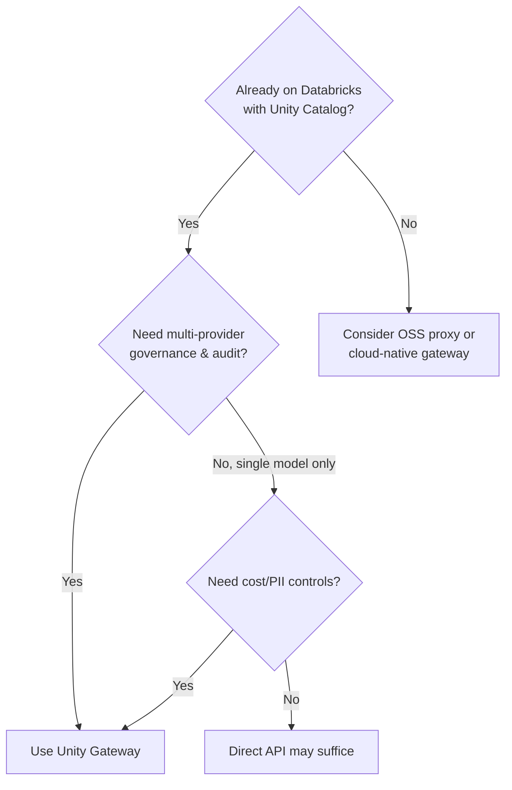

# Databricks Unity Gateway: Reference Card & Cheat Sheet

> **Status note (as of Nov 2026):** Unity Gateway (formerly/also called *Unity AI Gateway*, the successor of *Mosaic AI Gateway / AI Gateway for serving endpoints*) is a fast-moving product, partly in **Beta**. Facts marked ✅ come from Databricks docs; items marked 🔧 are **illustrative patterns**. Verify exact endpoint paths, SQL/CLI syntax, system table names and limits in the current docs (`docs.databricks.com/unity-gateway/`) before production use.

---

## 1. TL;DR

| Item | Summary |
|---|---|
| **What** | A single control plane for **model inference, tools (MCP), and skills** across AI apps, agents and coding agents ✅ |
| **Core promise** | One API → many models/providers, with routing, fallbacks, spend limits, guardrails, audit and usage tracking ✅ |
| **Governance model** | AI assets are registered as **Unity Catalog securables**; access uses the same GRANT/REVOKE model as tables ✅ |
| **Providers** | Databricks-hosted (Foundation Model APIs, open-weight & proprietary), OpenAI, Anthropic, Amazon Bedrock, Azure Foundry, custom serving endpoints ✅ |
| **Clients** | OpenAI-compatible clients (Python/JS/curl), coding agents (Cursor, Gemini CLI, Codex CLI, Claude Code), agents on Databricks Apps ✅ |
| **Security** | Identity-aware policies, PII masking, service policies (guardrails), audit logs ✅ |
| **Cost** | Beta: Unity AI Gateway features were not charged separately; underlying model usage is billable ✅ |
| **Not available** | AWS GovCloud, Azure Government (Beta docs) ✅ |

---

## 2. Naming & Lineage (avoid confusion)

| Name | Meaning |
|---|---|
| **AI Gateway for serving endpoints** (a.k.a. Mosaic AI Gateway) | Previous generation: governance features **attached to a model serving endpoint** (rate limits, guardrails, payload logging via inference tables, usage tracking) |
| **Unity (AI) Gateway** | New generation: a **workspace-level/account-level control plane** shown in the UI sidebar; treats models, MCP servers, skills and custom APIs as **UC securable objects** |
| **Unity Catalog (UC)** | Governance layer for data & AI assets; Unity Gateway reuses its permission model |
| **Model Service / MCP Service** | Gateway-level services that requests are routed to; service policies attach here ✅ |

---

## 3. Core Concepts

### 3.1 Glossary

| Concept | Explanation |
|---|---|
| **Gateway endpoint** | Stable, named URL/model alias that clients call. Behind it: one or more destination models |
| **Destination model** | The real model/provider backing an endpoint (e.g., a Databricks-hosted model, OpenAI, Anthropic, Bedrock) |
| **Routing** | Choosing the destination per request (static, weighted traffic split, best-fit for cost/speed/quality) |
| **Fallback** | Automatic retry on a secondary destination when the primary fails/throttles |
| **Traffic split** | Percentage-based distribution across backends (A/B tests, canary, capacity pooling) |
| **Rate limit** | Caps (e.g., tokens/queries per minute) at endpoint, user, group or service principal level |
| **Spend limit / budget** | Monetary caps and visibility on AI cost per principal/team/tag |
| **Service policy (guardrail)** | A function attached to a Model Service or MCP Service that decides how each request/response proceeds based on content and caller identity ✅ |
| **PII masking** | Detect and mask sensitive data in requests/responses ✅ |
| **MCP service** | Governed access to Model Context Protocol servers (external, self-hosted, or Databricks-managed) ✅ |
| **Skill** | Reusable, governed instruction bundles that extend agents; can be discovered, created and shared ✅ |
| **Custom API** | Govern arbitrary external APIs with the same access control, limits and logging as LLM endpoints ✅ |
| **Usage tracking** | Request/token/cost telemetry in **system tables** and a usage dashboard ✅ |
| **Inference / payload logging** | Request & response audit in Unity Catalog Delta tables ✅ |
| **Principal** | User, group, or service principal making the call; basis for identity-aware policy and cost attribution |
| **Tags** | Key/value labels for cost attribution and filtering |

### 3.2 The Three Pillars

```
┌────────────────────┬─────────────────────────┬───────────────────────────┐
│  ACCESS            │  OPTIMIZE               │  SECURE                   │
├────────────────────┼─────────────────────────┼───────────────────────────┤
│ One API, many      │ Routing, fallbacks,     │ Identity-aware permissions│
│ models/providers   │ traffic split, budgets, │ PII masking, guardrails,  │
│ MCP servers, tools │ spend limits, usage     │ audit logs, UC            │
│ Skills             │ dashboards              │ governance                │
└────────────────────┴─────────────────────────┴───────────────────────────┘
```

---

## 4. Architecture

### 4.1 High-Level Architecture



### 4.2 Request Lifecycle



### 4.3 Governance Model (Unity Catalog fit)



> 🔧 The exact securable types and privilege names (e.g., `EXECUTE`/`QUERY`/`USE`) differ by feature. Check the AI governance docs.

### 4.4 Control Plane vs Data Plane (conceptual)

| Layer | Responsibility |
|---|---|
| **Client layer** | SDKs, agents, coding tools; only know the gateway URL + token |
| **Gateway layer** | AuthN/Z, policy, limits, routing, logging |
| **Provider layer** | Models/tools; provider API keys are stored centrally (secrets), not in client code |
| **Governance/observability layer** | Unity Catalog, system tables, dashboards |

---

## 5. Functions & Elements (Feature Reference)

### 5.1 Feature Matrix

| # | Feature | What it does | Level |
|---|---|---|---|
| 1 | **Unified API** | OpenAI-compatible endpoint; swap models without code changes ✅ | Endpoint |
| 2 | **Permissions** | UC-based who-can-query/manage control ✅ | Endpoint / asset |
| 3 | **Foundation model permissions** | Restrict which Databricks-hosted FMs are allowed account-wide or per group ✅ | Account / group |
| 4 | **Rate limits** | Requests/tokens per time window | Endpoint / user / group |
| 5 | **Spend limits & budgets** | Cost caps and alerts | Principal / team |
| 6 | **Fallbacks** | Automatic secondary destination | Endpoint |
| 7 | **Traffic splitting** | Weighted routing, canary, A/B | Endpoint |
| 8 | **Smart routing** | Best-fit model/harness for cost, speed, quality ✅ | Endpoint |
| 9 | **Service policies (guardrails)** | Content- and identity-based allow/modify/deny functions ✅ | Model / MCP Service |
| 10 | **PII masking** | Redaction of sensitive data ✅ | Policy |
| 11 | **Usage tracking** | System tables + dashboard ✅ | Workspace/account |
| 12 | **Cost observability** | Cost by endpoint, destination model, principal, tag ✅ | Account |
| 13 | **Inference/payload logging** | Request/response audit into Delta tables ✅ | Endpoint |
| 14 | **Health monitoring** | Endpoint health & provider availability ✅ | Endpoint |
| 15 | **Coding-agent integration** | Route Cursor, Codex CLI, Gemini CLI, Claude Code via gateway ✅ | Client |
| 16 | **MCP services** | Connect external MCP servers, host your own, call Databricks MCP ✅ | Service |
| 17 | **Skills** | Discover/create/share governed agent skills ✅ | Asset |
| 18 | **Custom APIs** | Govern non-LLM APIs under the same controls ✅ | Service |
| 19 | **Bring-your-own capacity** | Use existing OpenAI/Anthropic/Bedrock/Azure Foundry contracts ✅ | Provider |
| 20 | **Open-weight model support for coding agents** | Run coding agents on supported open models ✅ | Endpoint |

### 5.2 UI Elements (typical navigation) 🔧

| UI area | Purpose |
|---|---|
| **Sidebar → AI Gateway / Unity Gateway** | Entry point |
| **Endpoints** | Create/edit gateway endpoints, destinations, routing |
| **Models / Providers** | Available models and external provider configs |
| **MCP / Tools** | Register and manage MCP services |
| **Skills** | Browse and share skills |
| **Policies** | Create service policies/guardrails |
| **Permissions tab** | Grant access to users/groups/SPs |
| **Usage / Cost dashboard** | Spend, tokens, errors, latency |
| **Account console → Previews** | Account admin enables Beta feature ✅ |

---

## 6. Setup Checklist

1. **Prerequisites**
   - Unity Catalog-enabled workspace; supported cloud (not GovCloud / Azure Government for the Beta).
   - Account admin enables the preview in **Account console → Previews** ✅.
   - Auth method: PAT, OAuth (M2M for service principals recommended in production).
2. **Decide governance structure**: groups (e.g., `ai-devs`, `ai-analysts`), service principals per app, tag taxonomy (`team`, `env`, `cost_center`).
3. **Register providers / models** (external keys stored in Databricks secrets or provider config).
4. **Create endpoints** with destinations, routing, fallbacks.
5. **Attach policies** (PII masking, allow-lists) and **limits** (rate, spend).
6. **Grant permissions** via UC.
7. **Enable logging** (usage tracking + inference logging).
8. **Integrate clients** (SDK, coding agents, apps).
9. **Monitor**: dashboards, alerts on spend and error rates.

---

## 7. Code Snippets

### 7.1 Query via OpenAI Python client ✅ (pattern from docs)

```python
import os
from openai import OpenAI

client = OpenAI(
    api_key=os.environ["DATABRICKS_TOKEN"],
    base_url="https://<workspace-url>/ai-gateway/mlflow/v1",
)

resp = client.chat.completions.create(
    model="databricks-gpt-5-2",      # gateway endpoint / model name
    messages=[
        {"role": "system", "content": "You are a concise assistant."},
        {"role": "user", "content": "What is Databricks?"},
    ],
    max_tokens=256,
)
print(resp.choices[0].message.content)
```

### 7.2 Streaming

```python
stream = client.chat.completions.create(
    model="databricks-gpt-5-2",
    messages=[{"role": "user", "content": "Explain Unity Catalog in 3 bullets"}],
    stream=True,
)
for chunk in stream:
    if chunk.choices and chunk.choices[0].delta.content:
        print(chunk.choices[0].delta.content, end="", flush=True)
```

### 7.3 curl smoke test 🔧

```bash
export DATABRICKS_HOST="https://<workspace-url>"
export DATABRICKS_TOKEN="<token>"

curl -sS "$DATABRICKS_HOST/ai-gateway/mlflow/v1/chat/completions" \
  -H "Authorization: Bearer $DATABRICKS_TOKEN" \
  -H "Content-Type: application/json" \
  -d '{
        "model": "databricks-gpt-5-2",
        "messages": [{"role":"user","content":"ping"}],
        "max_tokens": 20
      }'
```

### 7.4 Swap model without code changes

```python
import os
MODEL = os.getenv("LLM_ENDPOINT", "databricks-gpt-5-2")   # change via env/config only
resp = client.chat.completions.create(model=MODEL, messages=[{"role": "user", "content": "Hi"}])
```

### 7.5 Authentication for production (OAuth M2M, service principal) 🔧

```python
from databricks.sdk import WorkspaceClient
from openai import OpenAI

w = WorkspaceClient(
    host="https://<workspace-url>",
    client_id=os.environ["DATABRICKS_CLIENT_ID"],
    client_secret=os.environ["DATABRICKS_CLIENT_SECRET"],
)
token = w.config.authenticate()["Authorization"].split(" ")[1]

client = OpenAI(api_key=token, base_url="https://<workspace-url>/ai-gateway/mlflow/v1")
```

> Tokens expire; refresh per request or use a custom `http_client` with an auth hook in long-running services.

### 7.6 Create an endpoint via REST API 🔧 (illustrative payload)

> The management API schema for the new Unity Gateway may differ. Treat this as a pattern and check the API reference.

```bash
curl -X POST "$DATABRICKS_HOST/api/2.0/ai-gateway/endpoints" \
  -H "Authorization: Bearer $DATABRICKS_TOKEN" \
  -H "Content-Type: application/json" \
  -d '{
    "name": "chat-prod",
    "destinations": [
      {"name": "primary",  "model": "databricks-gpt-5-2", "traffic_percentage": 90},
      {"name": "canary",   "model": "my-anthropic-model", "traffic_percentage": 10}
    ],
    "fallback": {"enabled": true, "order": ["primary", "canary"]},
    "rate_limits": [
      {"principal": "group:ai-devs", "tokens_per_minute": 100000},
      {"principal": "endpoint",      "calls": 600, "renewal_period": "minute"}
    ],
    "tags": {"team": "platform", "env": "prod"}
  }'
```

### 7.7 Permissions (UC-style) 🔧

```sql
-- Pattern only: privilege and object names depend on the securable type
GRANT USE ON <ai_asset_type> `chat-prod` TO `ai-devs`;
REVOKE USE ON <ai_asset_type> `chat-prod` FROM `contractors`;
SHOW GRANTS ON <ai_asset_type> `chat-prod`;
```

### 7.8 Service policy (guardrail) function 🔧 pattern

Service policies are functions evaluated on each request/response and can use the content and the caller's identity ✅. Conceptual Python-style example:

```python
import re

PII_EMAIL = re.compile(r"[\w.+-]+@[\w-]+\.[\w.]+")
BLOCKED_GROUPS_FOR_EXTERNAL = {"contractors"}

def policy(ctx, request):
    """ctx: caller identity, groups, target service; request: payload"""
    text = " ".join(m["content"] for m in request["messages"])

    # 1) identity-aware rule
    if ctx.target_provider == "external" and BLOCKED_GROUPS_FOR_EXTERNAL & set(ctx.groups):
        return {"action": "deny", "reason": "External models not allowed for your group"}

    # 2) PII masking
    if PII_EMAIL.search(text):
        for m in request["messages"]:
            m["content"] = PII_EMAIL.sub("[EMAIL]", m["content"])
        return {"action": "modify", "request": request}

    return {"action": "allow"}
```

### 7.9 Usage & cost analysis in SQL 🔧

```sql
-- Billable usage (system table) filtered to AI Gateway related SKUs
SELECT usage_date,
       sku_name,
       custom_tags['team']            AS team,
       SUM(usage_quantity)            AS dbus
FROM   system.billing.usage
WHERE  usage_date >= date_sub(current_date(), 30)
  AND  (sku_name ILIKE '%AI_GATEWAY%' OR sku_name ILIKE '%SERVERLESS_REAL_TIME_INFERENCE%')
GROUP  BY ALL
ORDER  BY usage_date DESC;

-- Pattern: query inference/payload log table (name depends on your config)
SELECT request_time, requester, status_code, request, response
FROM   main.ai_gateway.chat_prod_payload
WHERE  request_time > current_timestamp() - INTERVAL 1 DAY
  AND  status_code >= 400;
```

### 7.10 Coding agents through the gateway 🔧

Most coding agents accept a custom base URL and key. Pattern:

```bash
# Codex CLI / OpenAI-compatible tools
export OPENAI_BASE_URL="https://<workspace-url>/ai-gateway/mlflow/v1"
export OPENAI_API_KEY="$DATABRICKS_TOKEN"

# Claude Code (Anthropic-style env vars; check the exact gateway path in docs)
export ANTHROPIC_BASE_URL="https://<workspace-url>/ai-gateway/anthropic"
export ANTHROPIC_AUTH_TOKEN="$DATABRICKS_TOKEN"
```

Benefits: central keys, per-developer spend limits, audit logs, model switching without touching dev machines.

### 7.11 MCP via gateway 🔧 (agent side)

```python
# Pattern: agent connects to a governed MCP service URL instead of the raw server
from databricks.sdk import WorkspaceClient
from databricks_mcp import DatabricksMCPClient   # package name may vary

w = WorkspaceClient()
mcp = DatabricksMCPClient(
    server_url="https://<workspace-url>/ai-gateway/mcp/<service-name>",
    workspace_client=w,
)
tools = mcp.list_tools()
result = mcp.call_tool("search_tickets", {"query": "payment failures"})
```

### 7.12 LangChain / LlamaIndex usage

```python
from langchain_openai import ChatOpenAI

llm = ChatOpenAI(
    model="databricks-gpt-5-2",
    api_key=os.environ["DATABRICKS_TOKEN"],
    base_url="https://<workspace-url>/ai-gateway/mlflow/v1",
    temperature=0,
)
print(llm.invoke("Summarize the benefits of an AI gateway.").content)
```

### 7.13 Retry & resilience on client side

```python
from tenacity import retry, stop_after_attempt, wait_exponential
from openai import RateLimitError, APIError

@retry(stop=stop_after_attempt(4), wait=wait_exponential(min=1, max=20),
       retry=lambda e: isinstance(e.outcome.exception(), (RateLimitError, APIError)))
def ask(prompt: str):
    return client.chat.completions.create(
        model=MODEL, messages=[{"role": "user", "content": prompt}]
    ).choices[0].message.content
```

### 7.14 Terraform skeleton 🔧

```hcl
# Pattern only: resource names/schemas depend on provider version
resource "databricks_ai_gateway_endpoint" "chat_prod" {
  name = "chat-prod"
  # destinations, routing, rate_limits ...
}

resource "databricks_grants" "chat_prod" {
  # grant privileges to groups
}
```

---

## 8. Operations Cheat Sheet

### 8.1 Typical HTTP Status Codes

| Code | Meaning | Action |
|---|---|---|
| 200 | OK | n/a |
| 400 | Bad request / policy-modified payload invalid | Check payload & policy |
| 401 | Auth failed | Refresh token |
| 403 | No permission / policy deny | Check UC grants & policies |
| 404 | Unknown endpoint/model | Check name |
| 429 | Rate/spend limit | Backoff, raise limit, use fallback |
| 5xx | Provider/gateway issue | Retry, rely on fallback, check health |

### 8.2 Troubleshooting

| Symptom | Likely cause | Fix |
|---|---|---|
| Feature not visible | Preview not enabled / unsupported cloud | Account admin enables in Previews |
| 403 on query | Missing privilege | Grant on endpoint/model service |
| Unexpected 429s | Group or endpoint rate limit | Inspect limits; separate SP per app |
| Responses missing in logs | Logging disabled or delay | Enable inference logging; allow ingestion lag |
| Cost not attributed | No tags / generic token | Use service principals + tags |
| Provider auth errors | Rotated external key | Update stored secret |
| Policy blocks legit traffic | Overly strict regex/rule | Test policy on sample set; add allow-list |

### 8.3 Operational Best Practices

- One **service principal per application/environment**; no shared PATs.
- Use **stable alias endpoints** (`chat-prod`) so models can be swapped silently.
- Roll out new models via **10% canary → 50% → 100%** traffic split.
- Always configure **fallback** to a different provider for critical paths.
- Set **per-team budgets** and alert at 50/80/100%.
- Enable **PII masking** before sending to external providers.
- Retain payload logs under **data-retention policies**; they may contain sensitive content.
- Review usage dashboard weekly; pin model versions for reproducibility.
- Version-control policies and endpoint configs (Terraform / Asset Bundles).

---

## 9. Typical Use Cases

| # | Use case | How Unity Gateway helps |
|---|---|---|
| 1 | **Enterprise LLM platform** | One governed API for all teams; central keys & audit |
| 2 | **Multi-provider strategy / avoid lock-in** | Switch OpenAI ↔ Anthropic ↔ open-weight without app changes |
| 3 | **Cost control** | Budgets, spend limits, cost attribution per team/user/tag |
| 4 | **Regulated data (PII)** | PII masking, identity-aware policies, audit trail |
| 5 | **Coding agent rollout** | Central capacity & keys; per-dev limits; use open models to save cost |
| 6 | **Agent platforms** | Governed MCP tools and skills; agents on Databricks Apps route via gateway |
| 7 | **Reliability / SLAs** | Fallbacks and load balancing across providers |
| 8 | **Safe model migration** | Canary traffic split and A/B comparisons |
| 9 | **Shadow-AI reduction** | Provide sanctioned access instead of unmanaged API keys |
| 10 | **Chargeback / FinOps** | System-table cost data joined with org structure |
| 11 | **Compliance evidence** | Inference logs in UC Delta tables, queryable for audits |
| 12 | **Govern non-LLM APIs** | Custom APIs behind same permissions/limits/logging |

### Example Architecture: Agent Platform



---

## 10. Pros & Cons

### Pros ✅

| Area | Benefit |
|---|---|
| **Centralization** | One control plane for models, tools, skills |
| **Governance** | Reuses Unity Catalog permissions; familiar GRANT model |
| **Lakehouse integration** | Logs and cost in Delta/system tables; join with business data |
| **Flexibility** | Many providers; bring your own capacity |
| **Compatibility** | OpenAI-style API; works with common SDKs and coding agents |
| **Cost management** | Budgets, limits, attribution, smart routing |
| **Security** | PII masking, guardrails, identity-aware policies |
| **Reliability** | Fallbacks and traffic splits |
| **No/low extra charge in Beta** | Features not billed separately during Beta ✅ |

### Cons / Risks ⚠️

| Area | Limitation / Risk |
|---|---|
| **Maturity** | Beta features; APIs, names, UI may change |
| **Availability** | Not on AWS GovCloud / Azure Government (Beta) ✅ |
| **Platform coupling** | Governance tied to Databricks/UC; migration away needs effort |
| **Extra hop** | Added latency vs. direct provider calls (usually small) |
| **Single control plane** | Misconfiguration or outage affects many apps; plan fallbacks |
| **Feature parity** | Provider-specific features (new params, beta APIs) may lag |
| **Complexity** | Policies, limits, routing need design and testing |
| **Cost model changes** | Pricing may change after Beta |
| **Naming confusion** | Old AI Gateway vs. Unity AI Gateway documentation overlap |
| **Data exposure** | Payload logs may hold sensitive prompts; needs retention & access control |

### Gateway vs. Alternatives

| Aspect | Unity Gateway | Open-source proxy (LiteLLM, etc.) | Cloud-native (Bedrock/Azure AI Foundry) | Direct provider API |
|---|---|---|---|---|
| Data/UC governance | ★★★ | ★ | ★★ (own cloud IAM) | ✗ |
| Multi-provider | ★★★ | ★★★ | ★★ | ✗ |
| Ops overhead | Low (managed) | Medium–High (self-host) | Low | Lowest |
| Customizability | Medium | High | Medium | n/a |
| Lock-in | Databricks | Low | Cloud | Provider |
| Cost tracking in lakehouse | ★★★ | Manual | Cloud billing | Manual |

---

## 11. Decision Guide



---

## 12. Security & Compliance Checklist

- [ ] Preview enabled by account admin; scope reviewed
- [ ] Service principals instead of personal tokens
- [ ] External provider keys stored in secrets, rotated regularly
- [ ] Least-privilege grants per group
- [ ] PII policy active for external destinations
- [ ] Rate and spend limits configured at endpoint **and** principal level
- [ ] Payload logging reviewed (retention, access, masking)
- [ ] Audit logs/system tables monitored; alerts on anomalies
- [ ] Fallback tested (chaos test: block primary)
- [ ] Documented model allow-list (foundation model permissions)

---

## 13. Quick-Reference Card (one page)

```
UNITY GATEWAY – QUICK CARD
──────────────────────────────────────────────────────────────
WHAT      Control plane for models + MCP tools + skills + custom APIs
BASE URL  https://<workspace>/ai-gateway/mlflow/v1   (OpenAI-compatible)
AUTH      Bearer PAT / OAuth M2M (prefer service principals)
ENABLE    Account console → Previews (Beta)
ASSETS    UC securables → GRANT/REVOKE
CONTROLS  Permissions | Rate limits | Spend limits | Service policies | PII masking
ROUTING   Static | Traffic split | Fallback | Best-fit (cost/speed/quality)
OBSERVE   System tables | Usage dashboard | Inference tables | Health
CLIENTS   OpenAI SDK, LangChain, curl, Cursor, Codex CLI, Gemini CLI, Claude Code
PROVIDERS Databricks FM, OpenAI, Anthropic, Bedrock, Azure Foundry, custom
LIMITS    No GovCloud / Azure Gov (Beta); features may change
GOTCHAS   Old "AI Gateway for serving endpoints" ≠ new Unity AI Gateway
```

---

## 14. Learning Path & Resources

1. Read: *Unity Gateway* overview → Quickstart → Available models.
2. Hands-on: send first request, connect a coding agent, add an MCP server.
3. Governance: AI governance → permissions → service policies.
4. Observability: usage dashboard + billable usage system table.
5. Advanced: routing/fallback design, policies as code, Terraform / Asset Bundles.

**Docs:** `https://docs.databricks.com/unity-gateway/` (AWS/GCP) · `https://learn.microsoft.com/azure/databricks/unity-gateway/` (Azure)

---

## 15. FAQ

**Is Unity Gateway the same as Model Serving?** No. Model Serving hosts models; the gateway governs access, routing and observability across hosted and external models and tools.

**Do I need to change my code?** Usually only `base_url`, token and model name when using OpenAI-compatible clients.

**Can I keep my own OpenAI/Anthropic contracts?** Yes, bring-your-own capacity is supported ✅.

**Where do I see cost?** Billable usage system table and the usage dashboard, by endpoint, destination model, principal and tags ✅.

**What if a provider is down?** Configure fallbacks and traffic splits; monitor health.

**Is it production-ready?** Parts are Beta; evaluate SLAs, support terms and API stability before critical workloads.

---

*Generated reference. Validate 🔧 items against current Databricks documentation.*
